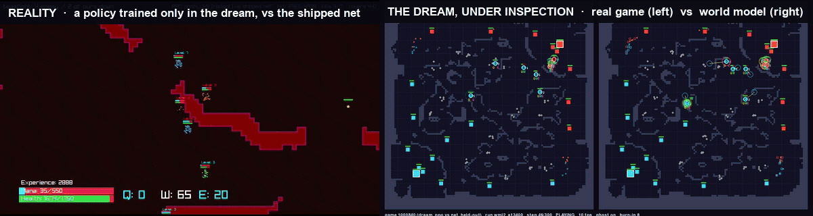
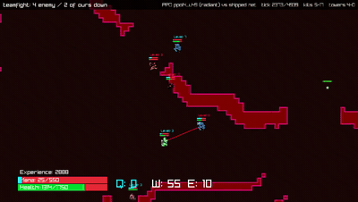
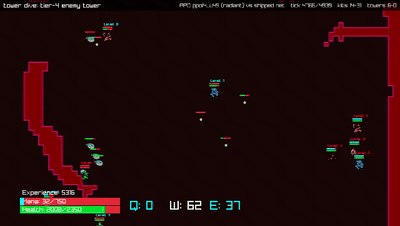
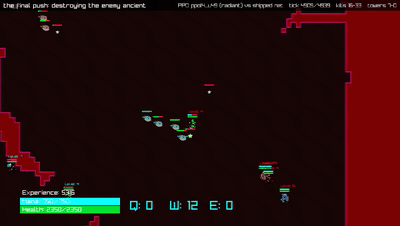
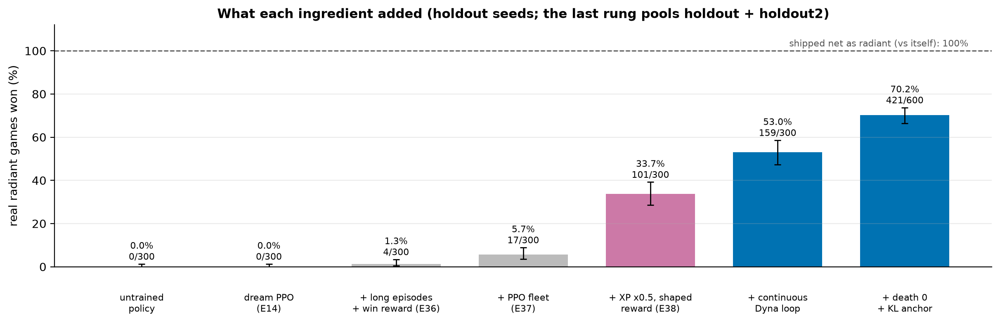
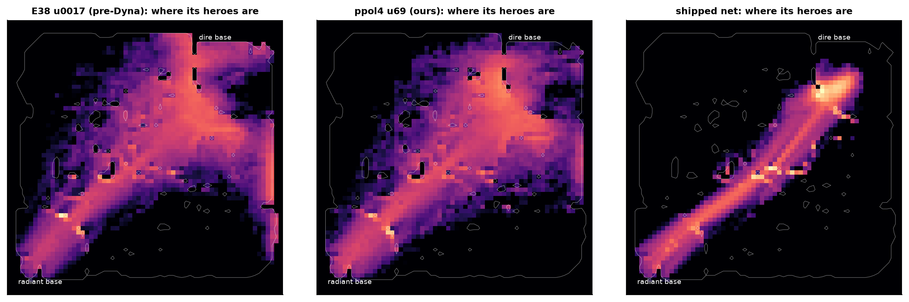
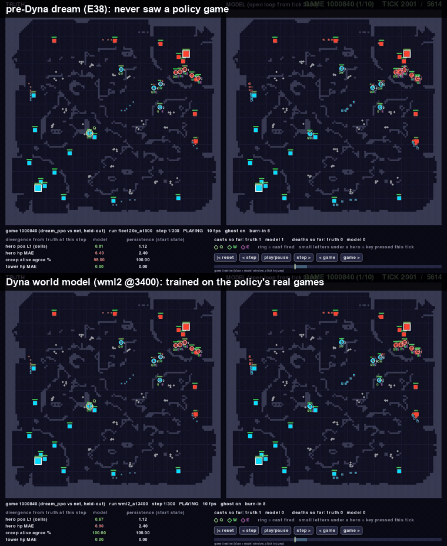
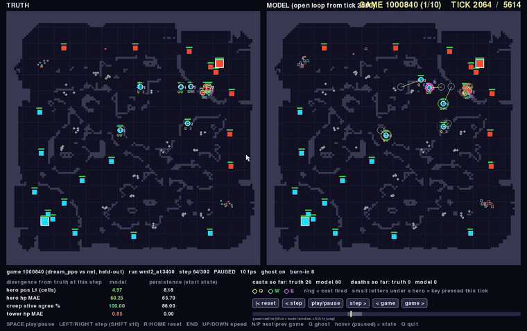

<p align="center">
  
</p>

<h1 align="center">Learning in Dreams, Winning in Reality</h1>
<p align="center"><b>A continuous Dyna loop for a ten-hero MOBA</b></p>
<p align="center">
  <a href="docs/moba/paper/paper.pdf"><b>📄 Paper (PDF)</b></a> ·
  <a href="docs/moba/paper/arxiv_submission.zip">arXiv source</a> ·
  <a href="docs/moba/paper/figures.ipynb">Figures notebook</a> ·
  <a href="docs/moba/experiments/README.md">Experiment log (E1–E40)</a> ·
  <a href="docs/moba/EVALUATION.md">Evaluation protocol</a>
</p>

---

**TL;DR.** We learn a structured world model of PufferLib's MOBA (206 units, ten heroes acting every tick), train a
policy *only* inside it on 1,400-tick imagined games, and judge it *only* in the real game against the policy the game
ships with. Run as a continuous Dyna loop, with real data repairing the model where the policy goes and real games
anchoring the policy, it wins **70.2% of real radiant games**, up from 0% for dream training alone. And it plays exactly
the game its world model can represent: the macro game of lanes and towers, not the micro game of stuns, timed heals and
coordinated kills.

| | radiant win rate (600 real games, untouched seeds) | dire |
|---|---|---|
| **our policy, trained only in the dream** | **70.2%** (421/600, 95% CI 66.4–73.7) | 0% |
| the same pipeline before the Dyna loop | 33.7% | 0% |
| dream training alone | 0% | 0% |
| *the shipped net, playing itself (reference)* | *100%, in less than half the time* | *0%* |

## The policy, in the real game

Every clip below is a **real game**, drawn by the game's own client. Our team (cyan) has never played a real game during
training; everything it does, it learned inside a 0.66M-parameter model of the game.

<table>
  <tr>
    <td align="center"><br><sub><b>Teamfight</b>: four enemy heroes down</sub></td>
    <td align="center"><br><sub><b>Tower dive</b>: a tier-4 tower falls</sub></td>
    <td align="center"><br><sub><b>The final push</b>: the enemy ancient falls</sub></td>
  </tr>
</table>

## What we found

**Dream training alone wins nothing, and naive training collapses.** Long imagined episodes with a win reward, and
less reward for the experience the dream overpays, bring the policy to a third of real radiant games. Then every
attempt to train further collapses: real wins fall to near zero within a handful of updates while every number inside
the dream looks fine. Only the real game shows what is happening: real kills and deaths fall in lockstep with real wins,
because the policy is learning to stop fighting.

**Two remedies turn the collapse into steady improvement.** The world model keeps training on the policy's newest real
games, which repairs it exactly where the policy goes. And the policy is tied by a KL penalty to the best real-game
policy so far, an anchor that moves only when a candidate wins on fresh seeds.

<p align="center"></p>

**The repair is measurable.** On the policy's own games, the world model before Dyna hallucinated 79% more tower falls
than happened, and was worse than predicting "nothing changes" for hero and tower health. After Dyna it is within 16% on
tower falls, with 2.4× less position error. With the PPO recipe held fixed, the Dyna-trained model alone is worth
**+9.2 points** [3.5, 14.7] of real win rate.

**The policy inherits its world model's fidelity profile.** Measured mechanic by mechanic, the world model captures
towers, lanes and aggregate damage, but almost no crowd control, the wrong timing for heals and casts, and too few
deaths. The policy mirrors that profile:

| the dream models… | …and so the policy |
|---|---|
| tower falls well (1.06× real) | takes ~10 towers per game, more than the shipped net |
| lanes and creep waves | pushes every lane with the waves |
| too few hero deaths (0.42× real) | over-extends: 3.3 deaths per kill |
| almost no stuns (0.17× real) | stuns before 7% of its kills (the net: 26%) |
| heals at the wrong moments | heals itself, not its allies |

The shipped net marches its five heroes down the middle lane and wins in under half the time. Ours spreads over the
whole map and wins by attrition:

<p align="center"></p>

## The world-model debugger

Aggregate losses say *that* a world model is wrong, not where, when, about whom or about which mechanic. The debugger
puts the real game and the dream side by side, from the same state and on the same actions of all ten heroes, so any
difference is the model's own error. Its timeline scrubs the whole game, any of the 206 units can be decomposed field
by field, an event layer shows casts, deaths and key presses, and a headless mode turns every view into a batch metric.
Every mechanistic claim in the paper started here.

<table>
  <tr>
    <td align="center" width="55%"><br><sub><b>Before Dyna (top) vs after (bottom)</b>, 300 ticks open loop on the policy's own game. Lines join each predicted hero to its true position.</sub></td>
    <td align="center" width="45%"><br><sub><b>Entity decomposition</b>: hovering a unit shows every field, real vs dream.</sub></td>
  </tr>
</table>

## Honest scope

The shipped net wins every one of its own radiant games, in less than half the time, so we claim that a policy trained
only in a dream wins most radiant games, not that it is the better player. Nobody wins as dire under this opponent, and
our dire play is barely better than random. The real game provides no gradients, but the loop played about 46,000 real
games to train the model and choose checkpoints, so this is not a sample-efficiency result. The world model uses
hand-coded rules for unit spawns and level-derived statistics. The whole project, failed directions included, cost $382
in attributed cloud spend (plus $214 unattributed on a shared account).

## Repository

| | |
|---|---|
| [`mobawm/`](mobawm) | the world model (`wm/`), dream PPO and the real-game arena (`rl/`), the FedAvg fleet link |
| [`moba/`](moba) | deterministic game capture, the data collector, the arena, and the real-client renderer (`moba_render.c`) |
| [`tools/`](tools) | `moba_viz.py` (the debugger), `pod.py` (RunPod), `fleet.py` (world-model fleets), `build.sh` |
| [`scripts/moba/`](scripts/moba) | evaluation (`seed_eval.py`), the paper's data pipeline (`paper_data.py`), mechanics and behaviour analyses, clip recording; `sweeps/` holds every launcher, including the continuous loop (`dyna_live.py`) |
| [`docs/moba/`](docs/moba) | the paper, the experiment log (E1–E40), the evaluation protocol, provenance and claims |
| [`artifacts/moba/`](artifacts/moba) | the released checkpoints: the headline policy, every ladder rung, and four world models |
| [`results/moba/`](results/moba) | every evaluation log and derived table behind the paper |

Every number in the paper regenerates from the logs:

```bash
python scripts/moba/paper_data.py
jupyter nbconvert --execute --inplace docs/moba/paper/figures.ipynb
```

The policies and world models behind every result are in [`artifacts/moba/`](artifacts/moba) (8 policies, including
every rung of the ladder, and the 4 world-model versions compared in the paper), with md5s. The game is
[PufferLib](https://github.com/PufferAI/PufferLib)'s Ocean MOBA, unmodified.

This is the third report in a line. [*Imitation Learning for Autonomous Driving in CARLA*](https://github.com/JordyKieto/carla-imitation-learning)
asked whether a policy can learn to act; [*Neural Simulator*](https://github.com/JordyKieto/neural-simulators) whether a
small learned model can stand in for a simulator; this one whether an agent taught inside such a model can win in the
real world.
