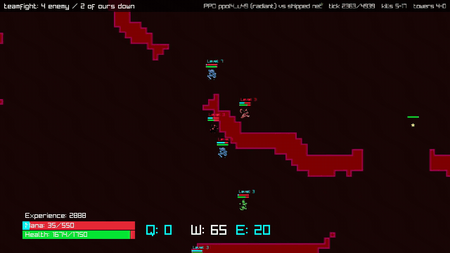
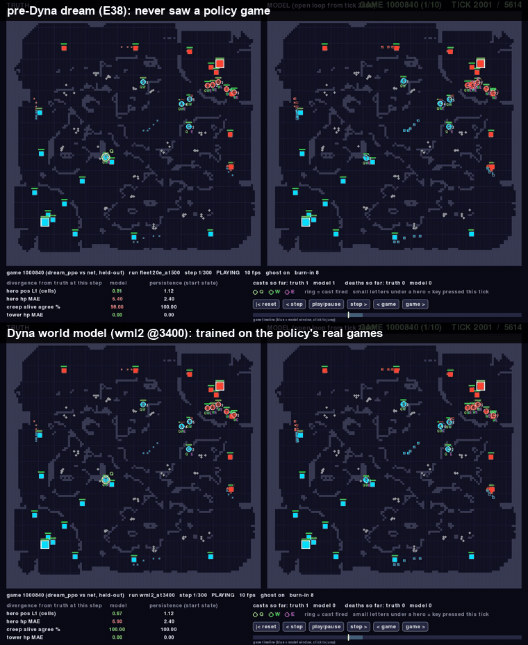
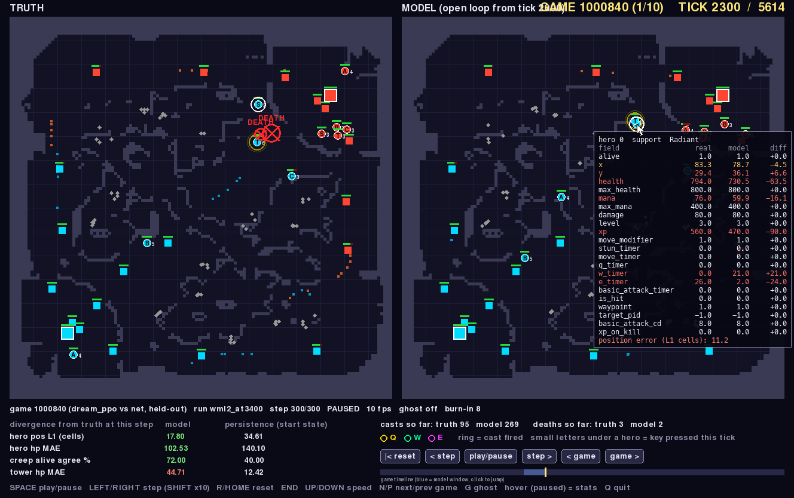
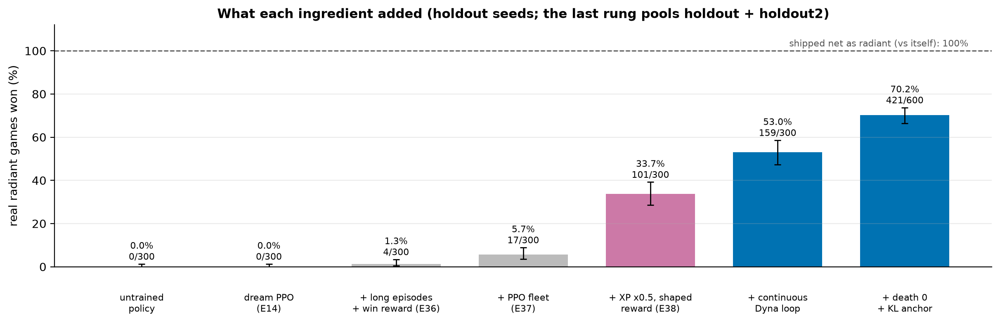
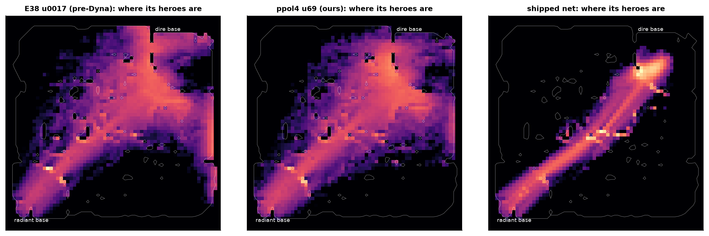
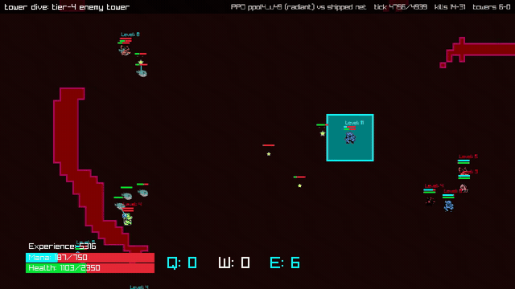
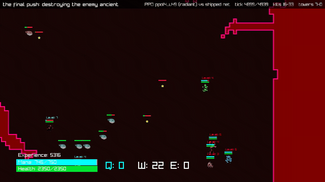

# Learning in Dreams, Winning in Reality: a continuous Dyna loop for a ten-hero MOBA

**Can a learned model of a whole ten-hero game be good enough that a policy trained only inside it wins the real game?**

This is the third report in a line:
- [`carla-imitation-learning`](https://github.com/) — learning to act;
- [`neural-simulators`](https://github.com/) — learning to simulate;
- this one — learning a world well enough to teach an agent in it.



*A policy that has only ever been trained inside the learned world model (radiant, cyan), playing a **real** game
against the shipped PufferNet (dire, red). Drawn by the game's own raylib client. Teamfight: 4 enemy heroes down.*

## The result

| | radiant | dire |
|---|---|---|
| **our dream-trained policy (ppol4 u69)**, 600 holdout games | **70.2%** won (421/600, 95% CI 66.4–73.7%) | **0%** (0/600) |
| the loop's starting policy (E38 best) | 33.7% | 0% |
| the shipped net, playing itself | 100% (300/300, in ~2,270 ticks) | 0% |

- **The win rates:** 600 real games on seeds that were never used for any decision ([evaluation protocol](EVALUATION.md)).
- **The game is lopsided:** with the shipped net on both sides, radiant wins every game. Our policy wins 70% of its
  radiant games, but slower than the net (~5,500 ticks), and loses every dire game, like the net does.
- **Every number** is regenerated by `scripts/moba/paper_data.py`. Every figure is in
  [paper/figures.ipynb](paper/figures.ipynb). An untrained policy wins 0% as radiant: the radiant side alone wins nothing.

## How

```
            real games of the current policy (collector)                     real-game evaluation (fixed / fresh / holdout seeds)
                 │                                                                      ▲              │ anchor + drift guard
                 ▼                                                                      │              ▼
   ┌────────────────────────────┐   checkpoint every ~7 min   ┌────────────────────────────────────┐
   │ world model (7 GPUs, FedAvg)│ ──────────────────────────▶ │ PPO in the dream (8 GPUs, FedAvg)  │──▶ policy every ~60 s
   │ 206 unit tokens + global    │                             │ vs an exact GPU port of the net    │
   │ ¼ of each batch: newest     │                             │ + KL(anchor ‖ policy), death 0     │
   │ policy games                │                             └────────────────────────────────────┘
   └────────────────────────────┘
```

1. **A structured multi-agent world model**: one token per unit (206) plus a global token, a GRU memory per unit, all
   ten heroes' actions as input, trained by autoregressive rollout ([architecture](WM_ARCHITECTURE.md)).
2. **PPO entirely inside it.** The real game never gives a gradient.
3. **A continuous Dyna loop**: the world model keeps training on the policy's newest real games while PPO keeps training
   in the newest world model, and nothing waits ([E39](experiments/E39-continuous-dyna.md)).
4. **An online evaluation service**: real games after every update, an anchor gate on fresh seeds, a drift guard, and
   reporting on untouched seeds only ([EVALUATION.md](EVALUATION.md)).

## The world-model debugger

**The instrument behind the mechanistic findings:**
- the real game and the dream side by side, from the same state and on the same actions of all ten heroes;
- a scrubbable timeline;
- field-by-field decomposition of all 206 units;
- an event layer for casts, deaths and key presses;
- divergence against "nothing changes";
- a headless API that turns every view into a batch metric.





- **What it shows:** the real game (left) and the world model's open-loop dream (right) from the same state, driven by
  the same actions of all ten heroes. Lines join each predicted hero to where it really is.
- **On the policy's own games:**

  | | world model before Dyna (top) | after Dyna (bottom) |
  |---|---|---|
  | predicted tower falls | 1.79× the real number | 1.16× |
  | hero position error after 300 ticks | 37.7 cells | 19.8 cells |

## What it took: each ingredient on the same untouched games



- **Dream PPO alone wins nothing.** Long episodes and a win reward give the first wins (1.3%). Less XP reward, because the
  dream overpays for farming: 34%.
- **The continuous Dyna loop: 53%.** Removing the death penalty and adding a KL anchor to the best real policy: 70%.
- **The world model's own share, with PPO held fixed:** a Dyna-trained model gives **+9.2 points [3.5, 14.7]** over the
  pre-Dyna dream (2 seeds each, frozen model, same recipe; [E40](experiments/E40-paper-evaluations.md)).
- **Without the KL anchor, every PPO run collapsed within 4–6 updates,** at any learning rate. The real game shows why:
  the policy learns to stop fighting. No in-dream metric shows it (Fig. 4).

## The central finding: the policy inherits its world model's fidelity profile

| the dream models… | …so the policy |
|---|---|
| tower falls well (1.06× real) | takes ~10 towers per game, more than the net |
| lanes and creep waves | pushes every lane with the waves |
| too few hero deaths (0.42× real) | over-extends: 3.3 deaths per kill |
| almost no stuns (0.17×) | stuns before only 7% of kills (the net: 26%) |
| heals at the wrong time | heals itself, not allies |

Mechanic by mechanic, what the world model can represent is what the policy learns ([paper §8.7](paper/paper.md)).
This is an inference, with an intervention test proposed.

## How it plays (and whether its heroes cooperate)



- **Ours:**
  - every ability, cast at the shipped net's rate;
  - heroes spread over every lane and the jungle;
  - pushing with the creep waves and trading three deaths per kill;
  - about 10 towers taken before the ancient falls, over ~5,600 ticks.
- **The shipped net:** five heroes marching down the middle together, winning in ~2,200.
- **Cooperation:** little. Our heroes group 9% of the time (the net: 54%), the support heals itself rather than its
  allies, and stuns rarely set up kills. What the five heroes share is a division of the map.

 

## Read more

- **Paper draft:** [paper/paper.md](paper/paper.md); figures in [paper/figures.ipynb](paper/figures.ipynb); claims in
  [paper/CLAIMS.md](paper/CLAIMS.md).
- **Experiments:** [experiments/README.md](experiments/README.md), one file per experiment (E1–E40).
- **Evaluation service:** [EVALUATION.md](EVALUATION.md).
- **Provenance:** [PROVENANCE.md](PROVENANCE.md).
- **Clips:** 12 one-minute clips of real games, with metadata, in `media/moba/clips/` (mirrored to
  `s3://puffertank/moba/media/clips/`).
