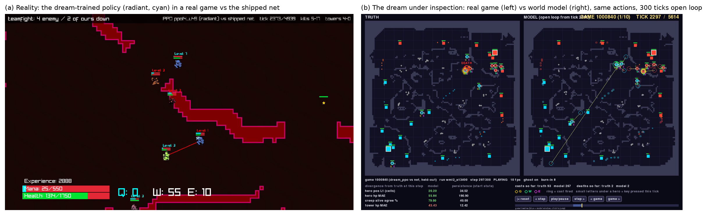

# Learning in Dreams, Winning in Reality: A Continuous Dyna Loop for a Ten-Hero MOBA

**[Read the paper (PDF)](paper.pdf)** · source [paper.tex](paper.tex) · arXiv package [arxiv_submission.zip](arxiv_submission.zip) ·
figures [figures.ipynb](figures.ipynb) · claims [CLAIMS.md](CLAIMS.md)

**TL;DR.** A policy trained only in a learned simulator of a ten-hero MOBA wins most of its real radiant games, but
only once real data repairs the simulator where the policy goes and real games keep the policy honest; what it learns,
and fails to learn, follows the simulator's fidelity, mechanic by mechanic.

The PDF is the paper. This page only points to it; the earlier markdown drafts of this report are in git history.
