# Learning in Dreams, Winning in Reality: A Continuous Dyna Loop for a Ten-Hero MOBA

*Technical report, draft of 2026-10-05. Every number is generated by `scripts/moba/paper_data.py` into
`results/moba/paper/numbers.json` and the figures by `docs/moba/paper/figures.ipynb`. Claims are graded in
[CLAIMS.md](CLAIMS.md) (M measured · Q qualitative · I inferred · U unverified, never stated as a result). The
evaluation protocol is [../EVALUATION.md](../EVALUATION.md). The previous draft of this report (2026-09-27, negative
transfer) is superseded. Its world-model results are kept in §5.*

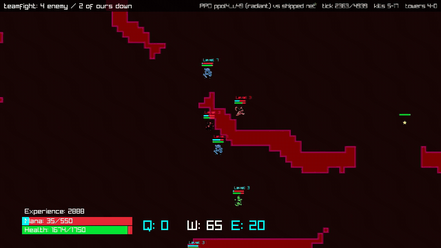

## Abstract

Can a learned model of a whole multi-agent game be good enough that a policy trained *only inside it* wins the real
game? We study PufferLib's Ocean MOBA: ten heroes, 206 units, every hero acting every tick, games of up to 6,000 ticks.

- **The world model:** a 0.66M-parameter token world model over every unit, conditioned on all ten heroes' actions,
  trained on recorded games and judged by open-loop rollouts on held-out games.
- **The policy:** a recurrent PufferLib policy, trained by PPO exclusively in the model's imagined games ("the dream")
  against an exact GPU port of the shipped PufferNet opponent.
- **The real game:** never provides a gradient. It is used in two ways: as data for the world model (the policy's own
  games, a Dyna loop), and as the judge (an online evaluation service).

**Results.**
- **Radiant:** the best policy wins **70.2% (421/600; 95% CI 66.4–73.7%)** of real games as radiant against the shipped
  net, on 600 games whose seeds were never used for any decision.
  - The policy that started the Dyna loop won 33.7%; an untrained policy wins 0%.
  - The game is radiant-sided: the shipped net playing itself wins 100% as radiant, in less than half the time our policy
    takes. Our policy is a competent but weaker radiant player.
- **Dire:** it wins **0 of 600**, as does the shipped net against itself (0 of 300). As dire it loses about as fast as
  a random policy.

**What gets there**, measured as a ladder on the same untouched seeds:

| ingredient | radiant wins |
|---|---|
| dream PPO alone | 0% |
| + long dream episodes and a win reward | 1.3% |
| + a PPO fleet | 5.7% |
| + less XP reward (the dream overpays for farming) | 33.7% |
| + a continuous Dyna loop | 53.0% |
| + removing the dream's death penalty and a KL penalty toward the best real-game policy so far | 70.2% |

- **The world model's own contribution,** from a matched control (same PPO recipe, 40 updates, two seeds each, the world
  model frozen before vs after Dyna): **+9.2 points [3.5, 14.7]**.
- **What Dyna changed in the world model,** on the policy's own real games:
  - it halves the over-prediction of tower falls (1.79× → 1.16× the real number);
  - it cuts hero position error after 200 ticks of open loop from 22.8 to 9.7 cells. Before Dyna, the dream was worse
    than holding the state still.

**Diagnosis.** Without the last two changes, every run lost its real-game ability within 4–6 updates, at any learning
rate. No in-dream training metric predicts real wins (|r| ≤ 0.37). The policy's real-game behaviour does (kills r =
0.84, deaths r = 0.82): collapse is the policy learning to stop fighting.

**How it plays.** The winning policy uses every ability at the shipped net's rate, but it does not play as a team.
- Its heroes are grouped 9% of the time (the net: 54%).
- Its support heals itself rather than its allies.
- Its stuns rarely set up kills.
- It wins by spreading across every lane, pushing with the creep waves and trading three deaths per kill, over ~5,600
  ticks.
- The shipped net marches all five heroes down the middle and wins in ~2,200 ticks.

**Released:** the deterministic game capture, the world-model debugger (real game and dream side by side), the
evaluation service and seed protocol, a renderer that records the real client, and every policy and log.

## 1. Introduction

Two earlier reports in this line asked the preceding questions:
- whether a policy can learn to act in a world from demonstrations (`carla-imitation-learning`);
- whether a compact model can stand in for a world as an interactive simulator (`neural-simulators`).

This report joins them: **can we learn a world well enough to teach an agent in it, and prove it in the real world?**

A model that predicts the next state well is not yet an environment. An environment must accept its own output as input
for thousands of ticks, under actions it did not choose. A policy optimised against it will find every error that pays.
The test of a learned world is therefore not its loss, but what an agent trained inside it does in the real game. We
make that test the centre of the method.

**Contributions** (each with how much it contributed: §8):
1. **A structured, multi-agent world model of a full MOBA** (§4–5). One token per unit (206) plus a global token, a GRU
   memory per unit, typed heads, all ten heroes' actions as input. Trained by autoregressive rollout, with a
   false-tower-death penalty that calibrates tower falls (predicted/real 0.97). Trained at scale across a 20-pod FedAvg
   fleet. Spawns and level-derived statistics are hand-coded rules (§4.3, disclosed).
2. **Dream PPO that transfers** (§6). Observations and the shipped-net opponent run exactly on the GPU (≈25k steps/s per
   A40, ≈135k on 8 pods). Long episodes, a win reward and less XP reward take dream policies from 0% to 34% real radiant
   wins.
3. **A continuous, asynchronous Dyna loop** (§7). The world model, PPO, real-game collection and evaluation run at the
   same time and never wait for each other. With a KL anchor to the best real-game policy, it takes the real radiant
   win rate from 34% to 70%.
4. **An online evaluation service** (§3, [EVALUATION.md](../EVALUATION.md)):
   - fixed / fresh / holdout seed sets with stated biases;
   - a fresh-seed gate for anchors;
   - a drift guard;
   - behavioural telemetry, which is how the collapse was diagnosed.
5. **A world-model debugger** (§3.2): the real game and the dream side by side on identical actions, per-unit
   inspection, and the same metrics in batch. It found the XP hallucination that broke the first transfer attempt, and
   it measures what Dyna changed (§8.3).

## 2. Related work

World models as learned simulators for policy learning:
- World Models (Ha & Schmidhuber 2018);
- Dreamer / DreamerV3 (Hafner et al.);
- token world models (IRIS, Δ-IRIS);
- MuZero, which plans in a learned latent rather than training a policy in a free-running simulator;
- model-based policy optimisation and its exploitation problem (MBPO, Janner et al. 2019);
- Dyna (Sutton 1991).

Multi-agent and game world models mostly predict pixels or short horizons. We model full symbolic state for 206 units
and roll out thousands of ticks. KL regularisation toward a reference policy is standard in RL from human feedback; here
the reference is chosen by real-game performance and moves. See [../PRIOR_WORK.md](../PRIOR_WORK.md).

## 3. Environment, opponent and evaluation

### 3.1 The game

- **Game:** PufferLib Ocean MOBA (upstream, unmodified, `42f70d69`), made deterministic and fully capturable
  (`moba/moba_game.h`). A restored state continues byte-for-byte (0/99 divergence).
- **Sides:** radiant and dire, 5 heroes each (support, assassin, burst, tank, carry), creep waves every 150 ticks,
  neutral camps, 22 towers + 2 ancients.
- **End:** a game ends when an ancient falls, or at 6,000 ticks.
- **Opponent:** the **shipped PufferNet** (`moba_weights.bin`), the policy PufferLib ships for this game, run from the
  data collector's own code. Our policy plays all five heroes of one side.

### 3.2 Data

All real games are recorded as seed + actions and replayed to dense per-tick state, verified by state hash. The totals
come from `results/moba/paper/compute.json` (`scripts/moba/compute_accounting.py`).

| corpus | games | who played | used for |
|---|---|---|---|
| `mix1k` | 1,000 (2.66M ticks) | the shipped net and scripted bots (net-net, net-script, script-net) | the base world-model corpus (900 train / 100 held out) |
| `mixrand1k` | 1,000 (2.61M ticks) | random, net and scripted mixes | off-distribution coverage (E11) |
| `dyna1`, `dyna2` | 100 + 810 | early dream policies vs the net, random and each other | the first Dyna data (E9, E12) |
| `dyna3_r1` | 300 | E38 policies vs the net | the start of the Dyna loop |
| `dyna_live` | 7,490 (27.0M ticks) | 205 distinct PPO checkpoints of the loop vs the net, alternating sides | the continuous Dyna loop |
| tower scenarios | 2.01M slices | from 12,794 tower-death events of training games | targeted tower training (E20–E21) |
| counterfactual forks | not stored | the real simulator, regenerated on demand | action-effect training (E6) |

- **Totals:** 10,700 real games and 234 GB in `s3://puffertank/moba/`.
- **Most of it is policy data:** 70% of the games are the policy's own, collected by the loop.

### 3.3 Instruments

- **Deterministic capture and replay:** dense per-tick state of all 206 units, verified by state hash on replay.
- **The world-model debugger** (`tools/moba_viz.py`): the real game (left) and the dream (right), started from the same
  real state and driven by the same recorded actions of all ten heroes, with ghost markers of true positions and per-unit
  tooltips. `scripts/moba/debugger_eval.py` computes the same divergence metrics in batch.

  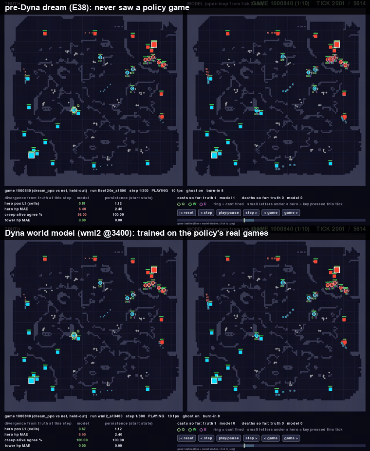

- **Real-client renderer** (`moba/moba_render.c`, `scripts/moba/record_clips.py`): the game's own raylib drawing code
  with a camera that frames the action, used for every gameplay video in this report.

### 3.4 Evaluation protocol

Full specification: [EVALUATION.md](../EVALUATION.md). In short:

| seed set | games | used for | may be reported as a win rate? |
|---|---|---|---|
| fixed (50000000+) | 60 per side, after every PPO update | training curves, drift guard, anchor candidates | **no**: picking the best of many updates on 60 games is optimistic (u0017: 45% fixed vs 34% holdout) |
| fresh (60000000+) | 300 per side, per anchor candidate | the anchor gate (≥ 9 more radiant wins than the anchor) | no: repeated selection, mildly optimistic (u69: 74% fresh vs 70% holdout) |
| **holdout** (70000000+) + **holdout2** (80000000+) | 300 per side each | **reporting only** | **yes** |

- **Intervals:** 95% Wilson intervals for rates, Newcombe for differences. A 6,000-tick game counts as not won.
- **Determinism:** re-running u0017, u71, u10 and u49 on the holdout reproduced every count exactly.
- **Real-game budget:** the real game was never a source of policy gradients, but it was used heavily for selection and
  world-model data. Exact counts are in `numbers.json → real_game_budget` and §9.

## 4. The world model

### 4.1 State and tokens
- **Tokens:** one per unit (206) and one global token.
- **Per unit:** position, health, mana, XP, ability and attack timers, status timers, alive and is-hit flags, and a 9×9
  wall patch.
- **Global token:** the phase of the creep-wave, neutral-respawn and rescan clocks.
- **Actions:** all ten heroes' actions (move y/x, attack target type, Q/W/E) are inputs at every step.

### 4.2 Architecture
- **Body:** two pre-LayerNorm transformer blocks over the 207 tokens, with full attention and a learned distance and
  team bias. The distance bias was rewritten as masked adds, an 11× training speed-up (E34).
- **Memory and heads:** a GRU per unit, then typed heads (regression, binary events, classification).
- **Size:** 0.66M parameters.
- **Training:** autoregressive rollout (the model fed its own predictions in chunks of 16, spans up to 4,096 ticks,
  decayed loss weights), plus a false-tower-death penalty (×1.5) that calibrated tower falls (E35).

### 4.3 What is not learned (disclosure)

Spawns (creep waves, neutral camps), creep constants, level from XP, level-derived stats, counters, clamps and target
resets are **hand-coded rules R1–R10** in the dream's state update ([WM_ARCHITECTURE.md](../WM_ARCHITECTURE.md)). They
were inherited from the first world model and are part of every result here. Everything dynamic is learned: movement,
fights, damage, mana, cooldowns, stuns, XP gains, deaths and respawns, and tower destruction. No game-logic rule was added
for any result in this report. The dream-PPO harness adds reward terms, which are listed in §6.

## 5. World-model results

### 5.1 One step vs rollout; towers (earlier experiments)
- **One step vs rollout:**
  - teacher-forced training has the best one-step loss but falls apart open loop (hero positions no better than
    copying the start state after ~300 ticks);
  - rollout training cuts held-out loss 5–12× from h64 on, at 2× the one-step loss;
  - real-simulator counterfactual siblings recover one-step precision and action effects.

  Table in `results/moba/tables/horizon_loss.md`; claims W1–W11.
- **Towers:** the false-tower-death penalty raised tower-fall precision from 40% to 71–77% on held-out corpus games, and at
  ×1.5 the dream predicts tower falls at the real rate (1,513 vs 1,561; E35).

### 5.2 How faithful is the dream on the games that matter: the policy's own

A world model that is accurate on its training corpus can still be wrong exactly where the policy goes. We measure every
world-model version on 100 real games of the current policy, collected after every evaluated checkpoint was taken.

**Open-loop divergence** (the debugger's metrics, in batch; 300 windows per model; error at 200 ticks; Fig. 12):

| world model | hero position (cells) | hero HP | tower HP |
|---|---|---|---|
| pre-Dyna E38 dream | 22.8 | 127.5 | 87.0 |
| Dyna round 1 | 13.6 | 79.6 | 64.0 |
| Dyna `wml` @3600 | 9.6 | 72.7 | 46.8 |
| **Dyna `wml2` @3400** | **9.7** | **69.4** | **42.7** |
| persistence (no change) | 28.5 | 104.9 | 48.8 |

**Tower falls** (5,265 windows of 128 ticks; Fig. 7):

| world model | precision | recall | predicted / real |
|---|---|---|---|
| pre-Dyna E38 dream | 28.6% | 51.0% | 1.79 |
| **Dyna `wml2` @3400** | **51.8%** | **60.1%** | **1.16** |

- **The pre-Dyna dream fails on the policy's own games.** It reached 71% tower precision on corpus games, but on these it
  hallucinates 79% extra tower falls and is worse than holding the state still for hero and tower health. This is the
  distribution shift the policy exploits.
- **Dyna removes most of that error.**

**Mechanic by mechanic** (Fig. 13; `scripts/moba/wm_mechanics_eval.py`). Each event detected in the real game and in the
dream is matched by hero within ±4 ticks, over 64-tick open-loop windows started every 200 ticks of the same 100 games.
Cells are precision / recall / dream-to-real count ratio:

| mechanic | real events | pre-Dyna E38 dream | Dyna `wml2` @3400 |
|---|---|---|---|
| ability casts (all 15 abilities, by cooldown reset) | 34,132 | 19% / 50% / 2.59 | 24% / 48% / 2.02 |
| tower falls | 231 | 14% / 23% / 1.68 | **33% / 35% / 1.06** |
| hero deaths (death + same-tick respawn) | 1,007 | 48% / 15% / 0.32 | 47% / 20% / 0.42 |
| heals ≥ 250 HP in a tick (support W, tank W) | 706 | 6% / 6% / 0.96 | 3% / 3% / 0.91 |
| speed buff (assassin E) | 2,508 | 24% / 55% / 2.25 | 30% / 63% / 2.08 |
| displacement 3–12 cells (blink strike, hook, knockback) | 3,200 | 4% / 23% / 6.16 | 5% / 16% / 3.55 |
| stun onsets (support E, burst E) | 257 | 2% / 2% / 0.67 | 2% / 0% / 0.17 |
| slow onsets (carry Q, W) | 267 | 3% / 2% / 0.52 | 3% / 1% / 0.34 |

What the dream models well, and what it does not:
- **Learned, and improved by Dyna: towers and the aggregate flow of a fight.**
  - Tower falls are calibrated (1.06×) and twice as precise.
  - Hero positions and health stay within ~10 cells / ~70 HP for 200 ticks (above).
  - The total amount of healing is right (0.91–0.96× the real count).
- **Ability usage is learned in rate, not in timing.** The dream fires abilities 2× too often, and only about a quarter
  of its casts match a real cast within ±4 ticks.
- **Hero deaths are under-predicted 2–3×.** Heroes survive fights in the dream that kill them in the real game.
- **Crowd control is essentially absent.** The dream reproduces almost no stun or slow onsets (0.2–0.7× the count, ≤ 3%
  matched). It invents displacement jumps 3.6–6× more often than they happen.

**The link to how the policy plays (§8.6), inferred, not tested.** A dream without stuns and with heals at the wrong
moments cannot reward "stun, then kill" or "heal the ally in the fight". The policy never learns them. A dream that is
lenient about hero deaths does not punish over-extension, and the policy trades 3.3 deaths per kill. What the dream does
model (towers, lanes, creep waves, aggregate damage) is what the policy learned to exploit: map-wide pushing.

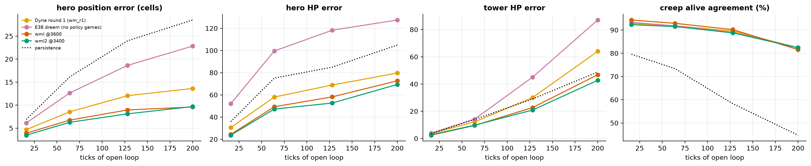

## 6. Dream PPO

- **Policy:** PufferLib's MOBA policy (encoder + 6-layer MinGRU), one network for all five heroes of its side, from the
  510-byte ego observation. Dream observations are rebuilt from dreamed state, byte-exact on real states.
- **Opponent in the dream:** the shipped net, ported to torch (logits within 5e-6 of the C implementation). Ours plays a
  random side each dream game.
- **Speed:** ≈25k agent steps/s per A40. A FedAvg fleet of 5–8 pods reaches 116–135k steps/s (E37, E39).
- **Reward (`all_handcrafted`, E38):**
  - win/loss ±100;
  - tower damage (k = 5, boost 2) and a fall bonus of 10;
  - champion kills (k = 2);
  - siege presence (0.02) and enemy-ancient damage (50);
  - the game's XP reward ×0.5;
  - from E39 on, the death penalty ×0.
- **Episodes:** 1,400 ticks.

## 7. The continuous Dyna loop

Four workers, no barrier between them ([E39](../experiments/E39-continuous-dyna.md)):

| worker | what | rate |
|---|---|---|
| world-model fleet (7 GPUs, FedAvg) | trains without stopping; ¼ of every batch from the 10 newest files (100 games) of the policy's real games | ~0.5 updates/s; a checkpoint every 200 updates |
| PPO fleet (8 GPUs, FedAvg) | trains without stopping; every rank swaps in each new world-model checkpoint at the same update | one update (~7M agent steps) per ~60 s |
| collector (CPU) | plays the newest policy against the shipped net, records + verifies the games | ~30 games/min |
| evaluator (CPU) | 60 real games per side for every new policy (fixed seeds); fresh-seed checks for anchor candidates | ~40 s per policy |

**Anchor and drift guard.**
- **Anchor:** the best real-game policy so far. PPO's loss includes 0.3 × KL(anchor ‖ policy).
- **Moving the anchor:** a policy matching the anchor on the fixed seeds is played 300 games per side on fresh seeds, and
  replaces the anchor if it wins ≥ 9 more radiant games.
- **Drift guard:** if three consecutive evaluations each fall to half the anchor's wins, every rank restarts from the
  anchor.

## 8. Results

### 8.1 Real-game win rate (holdout seeds, vs the shipped net)

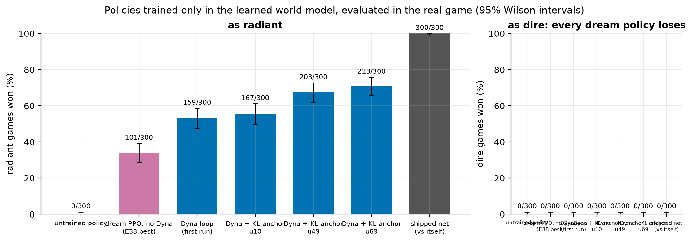

| policy | radiant | dire | towers / game (radiant) | game length radiant / dire |
|---|---|---|---|---|
| untrained policy | 0/300 (0%) | 0/300 | 0.17 | 6,000 (time limit) / 1,087 |
| **shipped net, playing itself** | **300/300 (100%)** | **0/300** | 4.39 | 2,269 / 2,269 |
| E38 best (u0017), start of the loop | 101/300 (33.7%) | 0/300 | 3.37 | 5,744 / 1,230 |
| Dyna loop, first run (ppol u71) | 159/300 (53.0%) | 0/300 | 3.77 | 5,652 / 1,220 |
| Dyna + KL anchor, u10 | 167/300 (55.7%) | 0/300 | 3.86 | 5,630 / 1,263 |
| Dyna + KL anchor, u49 | 203/300 (67.7%) | 0/300 | 3.90 | 5,486 / 1,270 |
| **Dyna + KL anchor, u69** | **213/300 (71.0%)**; holdout2 208/300 (69.3%); **pooled 421/600 = 70.2% [66.4, 73.7]** | **0/600** | 3.97 | 5,542 / 1,290 |

- **Differences:** vs the loop's start (u0017) +37.3 points [29.6, 44.4]; vs the first Dyna run (u71) +18.0 [10.3, 25.4].
- **How to read the headline:**
  - with the shipped net on both sides, radiant wins every game, so the game is lopsided under this opponent;
  - the radiant side alone wins nothing (untrained policy: 0%);
  - our policy reaches 70% where the net reaches 100%, and takes 2.4× longer;
  - as dire nobody wins, and our policy loses about as fast as a random one (1,290 vs 1,087 ticks; the net as dire lasts
    2,269).

### 8.2 The collapse, and what stops it

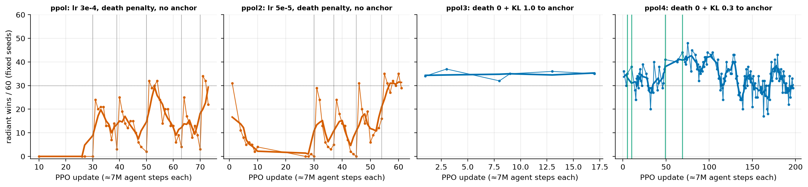

- **Without the death-penalty and KL changes, every run collapsed.** ppol (lr 3e-4) and ppol2 (lr 5e-5) fell from ~30/60
  to 0–8 within 4–6 updates. They needed 5 and 4 drift resets.
- **The learning rate is not the cause:** cutting it 6× cut the per-update KL 3× (median 0.0071 → 0.0022), yet the
  collapse took the same number of updates.
- **With death 0 + KL:** ppol3 (KL 1.0) held at the anchor's level, and ppol4 (KL 0.3) improved through three anchors (u5,
  u10, u49 → u69). Neither ever needed a reset.
- **The collector's own real games agree** (Fig. 3: 870 radiant games of ppol4 at 45–67% vs 0–27% for ppol/ppol2). They
  also show a late dip (updates 110–130) that the drift guard's threshold does not catch. It is reported, not hidden.

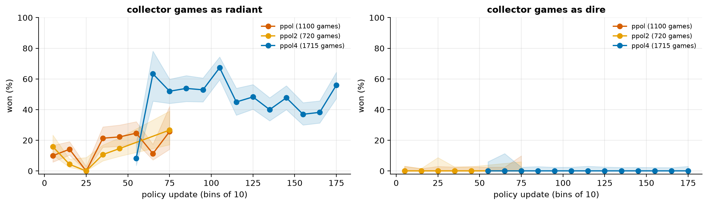

### 8.3 Why: the dream cannot see the collapse, the real game can

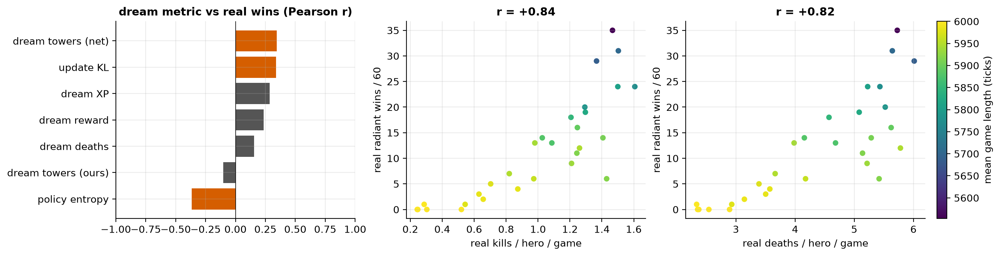

- **ppol2, updates 27–55:** no dream metric tracks real wins:
  - dream reward r = +0.23;
  - XP +0.29;
  - dream deaths +0.16;
  - our dream towers −0.10;
  - entropy −0.37.
- **The real-game behaviour does:** real kills r = +0.84, real deaths r = +0.82. Winning policies fight, die a lot (5–6
  deaths per hero per game) and push. Collapsing policies stop fighting (0.5 kills, 3 deaths) and games run to the time
  limit.
- **Why the dream drifts this way:** the dream's death penalty and its overpayment for safe XP make "do not fight" look
  good in imagination. The ablation (Fig. 8, left) confirms it, one seed per arm:
  - entropy bonus 0 does not help;
  - death penalty 0 delays the collapse by ~10 updates;
  - a KL anchor prevents it.

### 8.4 How much each part contributed

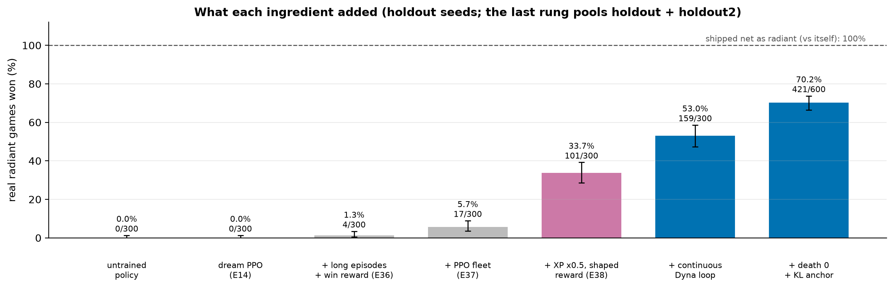

**(a) The ladder.** Each rung adds one change, all on the same 300 holdout games per side. The rungs are separate
experiments, each with its own seed and length, so a rung's step is what that change added in practice, not a matched
estimate.

| rung | change | radiant (holdout) |
|---|---|---|
| 0 | untrained policy | 0/300 (0%) |
| 1 | dream PPO with the game's reward, short episodes (E14 arm C) | 0/300 (0%) |
| 2 | + long episodes + win reward, calibrated dream (E36 best) | 4/300 (1.3%) |
| 3 | + 5-pod PPO fleet (E37 best checkpoint) | 17/300 (5.7%) |
| 4 | + shaped reward, XP ×0.5 (E38 u0017) | 101/300 (33.7%) |
| 5 | + continuous Dyna loop (ppol u71) | 159/300 (53.0%) |
| 6 | + death 0 + KL anchor (ppol4 u69) | 421/600 (70.2%) |

**(b) World-model quality vs PPO: the matched control (E40).** Same start (u71), same recipe (death 0 + KL 0.3 to u71),
40 updates, two seeds per arm. Only the frozen world model differs:

| world model (frozen) | seed 0 | seed 1 | pooled (holdout) |
|---|---|---|---|
| pre-Dyna E38 dream | 153/300 | 141/300 | 294/600 = 49.0% [45.0, 53.0] |
| Dyna-trained (`wml2` @3400) | 168/300 | 181/300 | 349/600 = 58.2% [54.2, 62.0] |

- **The world model's contribution: +9.2 points [3.5, 14.7].** In the pre-Dyna dream the anchored recipe slightly loses
  ground from the 53% start; in the Dyna model it gains.
- **The rest of the gap is not separated.** Between 58% (frozen Dyna model, fixed anchor, 2 pods, 40 updates) and 70% (the
  continuous loop: refreshed model, moving anchor, 8 pods, 69 updates), the remaining ~12 points come from those
  differences together.

**(c) The collapse fix (E39 ablation, fixed seeds, one seed per arm; Fig. 8 left):**
- entropy bonus 0 collapses like the baseline (0/60 by update 19);
- death penalty 0 delays the collapse (17–19/60 by update 20);
- KL to the anchor holds it (29–41/60 through update 22).

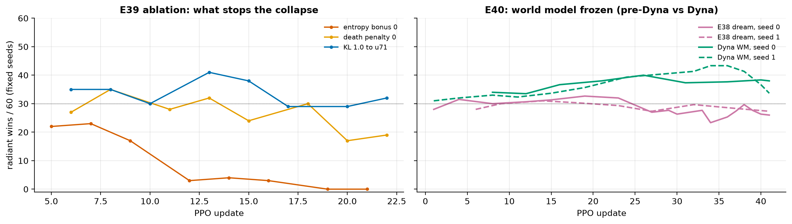

### 8.5 The world model during the loop

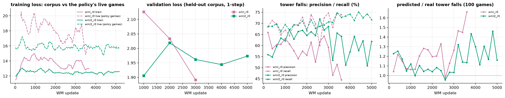

- **The gap was never closed.** On the policy's newest real games, the world model's loss stays above its loss on the
  corpus (live ≈ 15.5–16 vs train ≈ 12.5 for `wml2`).
- **Tower fidelity on held-out corpus games improved** under `wml2`: precision 55% → 65–72%, recall ~70%, predicted/real
  1.0–1.3.
- **The first fleet (`wml`) degraded.** It lost its followers to GPU memory at update ~1,550 and trained on one pod until
  it crashed at 3,675 (E39 §4). Its precision fell to 45–51%.

### 8.6 How the policy plays the real game, and whether its heroes cooperate

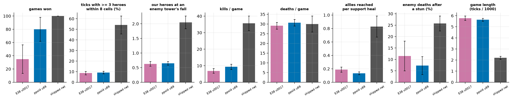
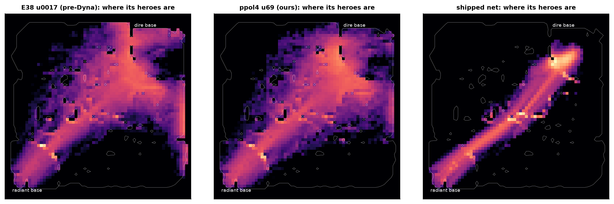

20 holdout games each, as radiant (`scripts/moba/behaviour_analysis.py`):

| | ours (ppol4 u69) | pre-Dyna (E38 u0017) | shipped net |
|---|---|---|---|
| won (these 20) | 80% | 35% | 100% |
| game length (ticks) | 5,634 | 5,778 | 2,200 |
| ≥ 3 heroes within 8 cells | 9% of ticks | 9% | 54% |
| our heroes at an enemy tower's fall | 0.65 | 0.63 | 2.05 |
| enemy towers destroyed | 9.95 | 9.30 | 6.2 |
| kills / deaths per game | 9.4 / 30.7 | 6.9 / 29.1 | 35.7 / 30.0 |
| support heal casts per minute / allies reached per cast | 4.4 / 0.13 | 4.4 / 0.19 | 4.7 / 0.83 |
| enemy deaths with a stun in the 20 ticks before | 7% | 12% | 26% |
| focus fire (2+ of ours on the same hero, when 2+ attack heroes) | 85% | 72% | 82% |

**Why it wins.**
- **The strategy:** the policy wins by **pressure, not teamwork**. Its heroes cover every lane and the jungle (Fig. 11),
  keep pushing with the creep waves, take ~10 towers per game (most fall with fewer than one of our heroes nearby, i.e.
  to creeps under hero pressure), and trade lives freely (3.3 deaths per kill). The shipped net as dire does not defend
  this well.
- **The shipped net's radiant play is the opposite:** a five-hero group marching down the middle lane that fights, stuns
  before kills, heals its allies and wins in under half the time.

**Cooperation.**
- **Little evidence of it.** The policy uses every ability at the net's rate, and when two of its heroes engage the same
  enemy they do focus fire (85%). But they rarely engage together, the support's heal almost never reaches an ally, and
  stuns rarely set up kills.
- **What exists is a division of the map** across five heroes driven by one shared network.
- **The Dyna loop sharpened E38's strategy rather than changing it:** same shape, more kills, more focus fire, more
  towers, more than double the wins.

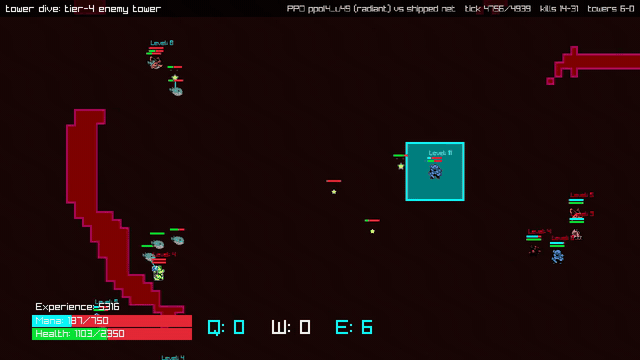 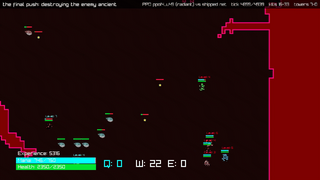

12 one-minute clips of ppol4 u49 on holdout seeds, drawn by the real client, are in
`s3://puffertank/moba/media/clips/2026-10-05_ppol4_u49/`, each with a metadata JSON (policy md5, seed, ticks, events,
camera track).

## 9. Limitations and threats to validity

- **Dire: 0 wins in every evaluation of every policy** (0/600 for the best). Against this opponent that is also the
  shipped net's own result (0/300 as dire against itself), but our policy's dire play is barely better than random: it
  loses in ~1,290 ticks vs random's ~1,090 and the net's ~2,270. No dream-trained policy has learned to defend.
- **The radiant result is against a radiant-sided game.** The shipped net wins 100% as radiant. We claim that a policy
  trained only in the dream wins most radiant games, not that it beats the shipped net at the game.
- **One opponent.** All results are against the shipped PufferNet. We make no claim about other opponents or humans.
- **One seed per configuration** for the loop runs. The 70% is one policy's holdout score, not a distribution over
  training runs. The E40 control adds a second seed for two configurations.
- **Selection.** Holdout was never used to choose anything, but 13 PPO policies (including the ladder and the E40
  arms) have been evaluated on it, and the headline reports the best of them. holdout2 (one policy) reproduces it (69.3% vs 71.0%).
- **The real game is in the loop, at scale.** It provides no policy gradients, but the loop played ~46,000 real games
  against the shipped net:
  - 28,680 after-update evaluations;
  - 9,600 anchor checks;
  - 7,490 collector games for the world model;
  - plus 9,000 holdout games for reporting.

  That is roughly 0.2B real ticks next to ~2.5B dream agent steps (~0.5B dream ticks). **We make no sample-efficiency
  claim:** most of those games select checkpoints. A cheaper selection signal (fewer evaluations, smaller fresh checks) is
  future work. The pure "dream only" results are E36–E38 (≤ 33.7%).
- **Hand-coded rules R1–R10** in the world model's state update (§4.3).
- **Infrastructure incidents** that changed what ran (E39 §4):
  - the first world-model fleet ran on one pod for most of its life;
  - the collector stopped for 2 hours on a full disk.

## 10. Compute and cost (the whole project, not just the successful track)

From RunPod's billing records per pod per day (2026-09-22 → 2026-10-05), attributed to this project by pod id (state
files and creation logs; `scripts/moba/compute_accounting.py` → `results/moba/paper/compute.json`):

| purpose | cost | pod-hours |
|---|---|---|
| world-model training and ablations (E1–E35, incl. the 20-pod fleets) | $217 | 103 |
| dream-PPO sweeps and fleets (E36–E38: ~100 arms) | $88 | 89 |
| continuous Dyna loop (7 world-model + 8 PPO pods, E39) | $53 | 80 |
| frozen-world-model control (E40) | $1.4 | 1.3 |
| other pods of this project (smoke tests, setup) | $22 | 7 |
| **attributed total** | **$382** | **279 (272 GPU, 7 CPU)** |
| unattributed spend on the same account in the window (mostly 09-22 to 09-28, H200-class) | $214 | 60 |
| network volumes | $18 | |
| before the billing records begin (E1–E6 on H200/H100, PROVENANCE §3.4, estimated) | ~$100 | ~22 |

- **Hardware:** A40 ≈ 209 GPU-hours (~$124); H200 ≈ 51 h (~$228); A100 ≈ 9 h; H100 ≈ 3 h; CPU (32 vCPU) ≈ 7 h. The
  type is inferred from the hourly price where the pod record does not name it.
- **The expensive part was the world model,** run early on single H200s. The loop that produced the result ran on A40s
  at ~$13/hour.
- **Unattributed $214:** most likely this repository's early pods, whose state files were overwritten when a name was
  reused, but the account is shared. We report it rather than claim it.
- **Wall clock:** the MOBA track ran 2026-09-25 → 2026-10-05, 11 days. The Dyna loop's result came within ~4.5 hours
  of its launch.

## 11. Reproducibility

- **Code:** everything is in this repository.
  - Game capture, renderer: `moba/`.
  - World model, dream PPO, arena: `mobawm/`.
  - Evaluation, data pipeline, clips: `scripts/moba/`.
  - Launchers: `scripts/moba/sweeps/`.
- **Policies:** every evaluated policy is in `s3://puffertank/moba/dream_policies/`, md5s in the experiment records.
- **Figures and numbers:**
  `python scripts/moba/paper_data.py && jupyter nbconvert --execute --inplace docs/moba/paper/figures.ipynb`.
- **Updating the headline** when a new anchor beats it: [EVALUATION.md §5](../EVALUATION.md).
